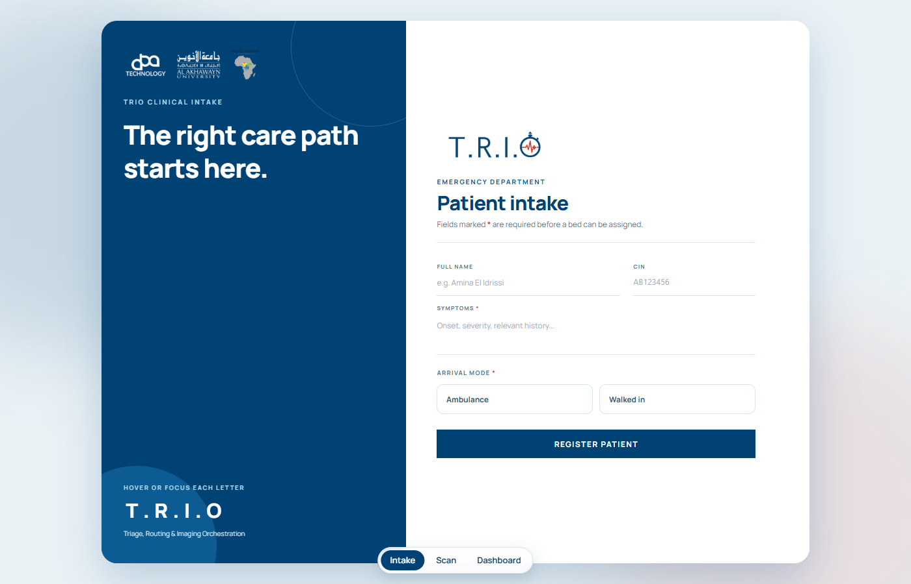
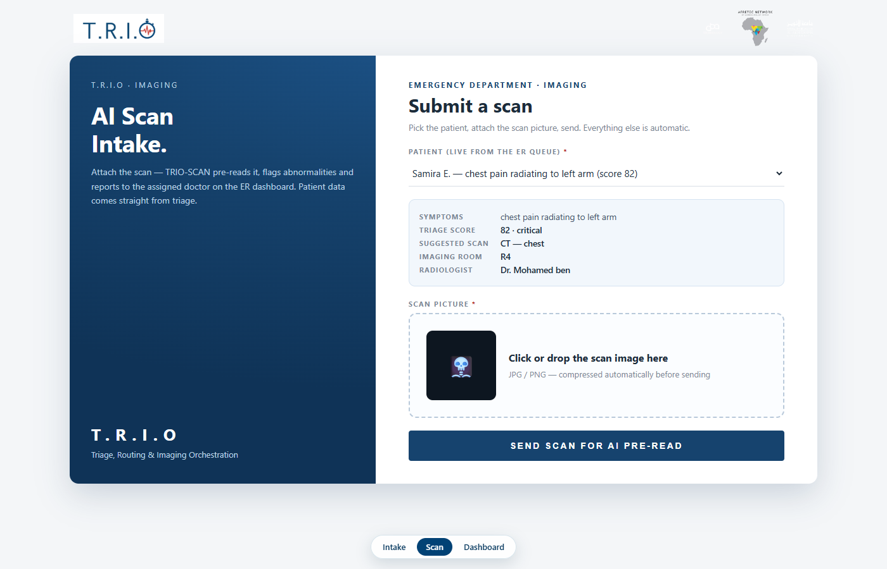
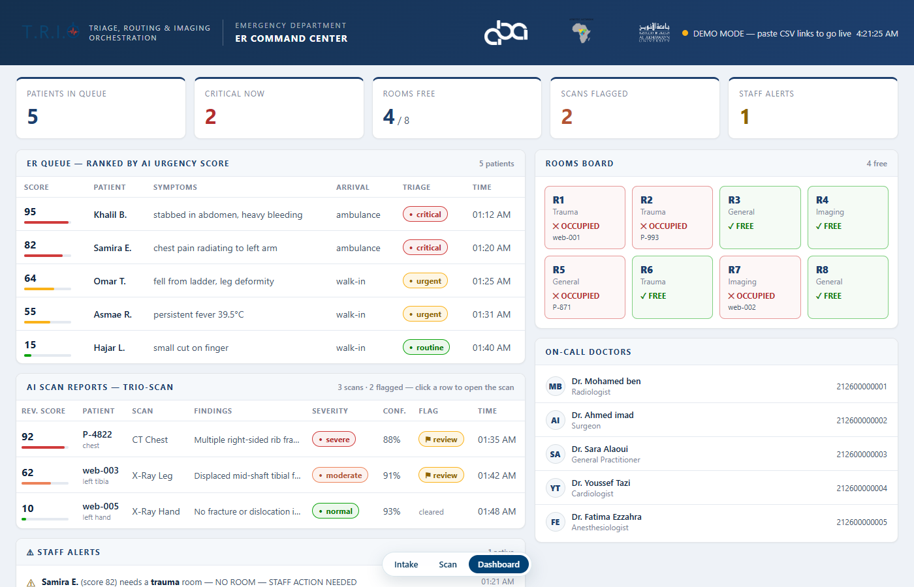

# T.R.I.O: Triage, Routing & Imaging Orchestration

An AI-assisted emergency-department workflow for radiology: patients are triaged from their symptoms at intake, routed to an imaging room and a radiologist, and their scans get an AI pre-read before a doctor looks at them.

Built in a team of five at the **Fusion AI Hackathon** (AUI AI Summer School 2026), with ABA Technology and the Afretec Network.

## The problem

Radiologists read large volumes of scans under time pressure, and fatigue is linked to missed findings. In the emergency department, urgent cases can wait in the same queue as routine ones. TRIO puts the most urgent patients first and gives the radiologist a pre-read to start from, without taking the decision away from the doctor.

## How it works

```text
 Patient intake form (/)                Scan intake page (/scan)
   name, ID, symptoms, arrival mode        pick a patient from the live ER queue,
            │                              attach the scan image
            ▼ /api/entries                           │ /api/scan
   ┌──────────────────────────────┐        ┌────────────────────────────────┐
   │ TRIO-INTAKE automation        │        │ TRIO-SCAN automation            │
   │ LLM triage → urgency score,   │        │ AI pre-read of the image,       │
   │ queue entry, alerts           │        │ flags abnormalities, reports    │
   └──────────────────────────────┘        │ to the assigned radiologist     │
                    │                       └────────────────────────────────┘
                    ▼                                    │
          TRIO-DB (Google Sheets): patients · imaging rooms · doctors
                    │
                    ▼
     ER dashboard (/dashboard) + WhatsApp alerts to staff
```

- **Intake** (`app/`): a responsive Next.js form. The server route forwards the submission to the triage automation, so the webhook URL never reaches the browser.
- **Triage**: an LLM node in the Fusion visual automation platform scores urgency from the symptoms using a clinical triage prompt with structured JSON output. The automation itself lives in the Fusion platform, not in this repo.
- **Scan intake** (`public/scan/`, served at `/scan`): a single-page tool for the imaging desk. It loads the ER queue sorted by urgency, suggests the scan type and region from the symptoms, picks a free imaging room and an on-call radiologist, compresses the image and sends it for the AI pre-read.
- **ER dashboard** (`public/dashboard/`, served at `/dashboard`): the command-center screen for staff. It polls TRIO-DB every 5 seconds and shows the patient queue by urgency, imaging-room status, alerts, on-call doctors and the AI scan reports.

| Patient intake | Scan intake |
|---|---|
|  |  |



## Running it

One Next.js app serves all three pages, linked by a switcher at the bottom of each page:

| Page | Path | Live |
|---|---|---|
| Patient intake form | `/` | [open](https://aiss-trio-hackathon-mjhp.vercel.app/) |
| Scan intake | `/scan` | [open](https://aiss-trio-hackathon-mjhp.vercel.app/scan) |
| ER dashboard | `/dashboard` | [open](https://aiss-trio-hackathon-mjhp.vercel.app/dashboard) |

The scan intake and the dashboard run on sample patients until the published-CSV links of the TRIO-DB tabs are pasted into their config. Submitting a patient or a scan needs the automations' webhooks.

```bash
npm install
cp .env.example .env.local   # set TRIO_WEBHOOK_URL and TRIO_SCAN_WEBHOOK_URL
npm run dev                  # http://localhost:3000, /scan, /dashboard
```

## Tech stack

Next.js 16 · React 19 · TypeScript · Tailwind CSS 4 · Vercel · Fusion AI automation platform · Groq LLM · Google Sheets · WhatsApp (Green API)

## Team

- **Jihane Erraji** and **Khalil Berjaoui**: programming
- **Mehdi El Karimi**: intake form design
- Zineb El Koussaimi
- Asma Ouabd
